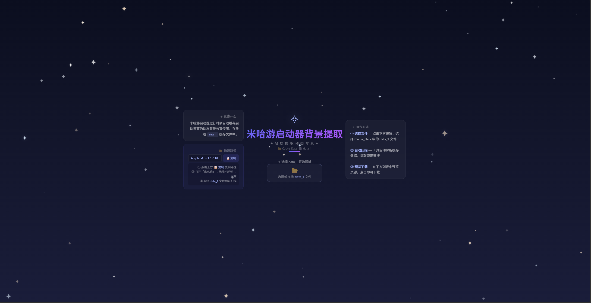

# ✧ 米哈游启动器背景提取器

一键提取米哈游启动器中的动态背景视频与宣传图片,纯前端运行,不上传任何文件。

## 功能

- 🎬 提取启动器动态背景视频(.webm/.mp4)
- 🖼️ 提取游戏宣传图片(.png/.jpg/.webp)
- 📄 扫描缓存配置文件(.json/.html/.js 等)
- ⚡ 拖拽上传或点击选择文件,支持多选 `data_0`~`data_3`
- 📋 一键复制资源链接,点击即可预览
- 🗂️ 按 视频 / 图片 / 其他 分类统计与筛选
- 🚀 单次线性扫描 + 分块读取,处理大文件不卡顿、不占内存

## 使用方法

1. 打开米哈游启动器(让它加载过背景)
2. 进入缓存目录:
   ```
   %AppData%\miHoYo\HYP\1_1\fedata\Cache\Cache_Data
   ```
3. 选择 `data_1` 文件(可多选 `data_0`~`data_3`)
4. 等待扫描完成,即可预览和下载资源

## 在线使用

点击此链接使用:https://sophie92-spec.github.io/fictional-fortnight/

## 效果图



## 技术说明

- 纯前端 HTML + CSS + JavaScript(拆分为 `index.html` / `style.css` / `script.js`),静态部署,无需构建
- 通过解析 Chromium Simple Cache 格式,从字节流中提取资源链接
- 扫描算法为单次线性扫描(替换原三重循环),配合 8MB 分块 + 64KB 重叠窗口读取
  大文件,既避免内存峰值,也防止 URL 跨块截断丢失
- 结果按 URL 去重,分类统计并支持筛选
- 所有处理在浏览器本地完成,不上传任何文件
